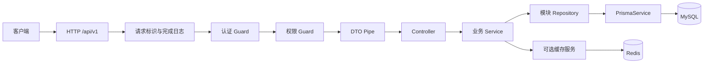

# 模块化单体架构

更新：2026-10-23。文档状态：已更新；目标方案仍见提议中的 [ADR 0001](../decisions/0001-modular-monolith.md)。当前已有 Health、Users 和 Prisma 模块，模块目录与部分职责尚未按目标收拢；阶段 01 及 Swagger 局部历史验收不代表数据库业务已验证。

## 当前实现与目标差异

2026-10-23 静态盘点，以下只描述可检查的代码，不代表数据库运行验收。

```text
project/src/
  bootstrap/configure-app.ts   # 共用前缀、URI 版本和 ValidationPipe（并行修改，未复验）
  bootstrap/configure-swagger.ts # 已从 main 提取并接线，运行行为未验收
  config/env.validation.ts    # 已校验启动/Observe/Swagger，DB 尚未纳入
  modules/health/             # 已有存活接口
  modules/users/             # 已移动，含 Controller、Service、DTO 和 OpenAPI 响应模型
  database/prisma/           # 全局 PrismaModule、连接/关闭生命周期
  generated/prisma/          # 本地生成产物，忽略入库
  app.module.ts              # 静态导入 Health、Prisma、Users
  main.ts                    # 调用共用 HTTP 与 Swagger 初始化
```

当前调用关系为 `UsersController → UsersService → PrismaService`，没有 UsersRepository；UsersService 直接返回 Prisma 记录，Swagger 响应模型仅描述契约，不执行字段过滤。PrismaModule 使用 `@Global()`，UsersModule 尚未显式导入它。User/Role/UserRole 已有模型和迁移文件，认证/权限 Guard、Redis、统一响应/异常和请求标识仍未实现。

后文请求链、职责和安全约束均为目标；当前硬删除及匿名 CRUD 与目标有差距，待阶段 02～06 补齐。阶段状态见[导航](../README.md)，具体差异以各阶段文档为准。

## 目标请求与模块边界



成功由响应拦截器包装，异常由全局过滤器输出安全错误。Guard 在 Pipe 之前运行，不能依赖 DTO 已转换或校验；认证服务自行校验 token。完成日志在 response finish/close 收集最终状态，覆盖 Guard、Pipe 和过滤器提前返回的请求。

## 职责划分

| 层/模块 | 负责 | 不负责 |
| --- | --- | --- |
| Controller | 路由、DTO、状态码、Swagger、调用用例 | Prisma 查询、哈希和跨表事务 |
| 业务 Service | 不变量、对象级权限、事务边界、调用领域协作者 | HTTP response、通用数据库封装 |
| 模块 Repository | Prisma 查询、软删条件、select 白名单、接收 TransactionClient | HTTP 状态、绕过业务授权 |
| PrismaModule（数据库基础设施） | 一个 PrismaService、适配器、连接生命周期 | 用户/角色等业务规则 |
| AuthModule | 密码、JWT、会话、全局认证 Guard | 角色权限配置 |
| AuthorizationModule | 权限装饰器/Guard、角色分配、权限版本 | 签发 token |
| UsersModule | 身份资料和状态，对外导出 UsersService | 导出 Repository 给其他模块直接写表 |
| RedisModule | 单个 Redis 连接、关闭和故障事件 | 作为身份/权限权威数据源 |
| Common | 纯装饰器、DTO 基类、过滤器、拦截器 | 汇总各业务 Service 的“大公共模块” |

Repository 只在存在实际查询时创建，每业务模块一个具体类即可，不创建 BaseRepository、DDD 层套层或工作单元框架。数据库资源模块显式导入，配置模块可全局加载。

依赖方向：`AppModule → Users/Auth/Authorization/Health`；`Auth → Users + Database`；`Authorization → Users + Database`；`Users → Database`。认证只读取用户和会话，不依赖权限模块；权限模块不反向导入 Auth。路由元数据/用户上下文类型放 common，避免循环依赖。用户禁用、删除、改密码在数据库事务里更新用户版本并撤销会话，无需 Users 调用 Auth。

## 目标目录（不是当前已存在的目录）

```text
doc/                         # 唯一技术文档源
AGENTS.md                    # 会话核心规则
project/
  prisma/schema.prisma
  prisma/migrations/
  prisma7.config.ts
  src/
    bootstrap/{configure-app,configure-swagger}.ts
    config/env.validation.ts
    common/{decorators,dto,filters,interceptors,middleware,types}/
    database/prisma/{database-options,prisma.module,prisma.service}.ts
    infrastructure/redis/{redis.module,redis.service}.ts
    modules/
      users/{dto,users.controller,users.service,users.repository,users.module}.ts
      auth/{dto,guards,auth.controller,auth.service,auth.module}.ts
      authorization/{dto,guards,authorization.module,authorization.service}.ts
      health/
      files/
      audit/
    generated/prisma/        # generate 产物，不手改，不入库
    app.module.ts
    main.ts
  test/
  Dockerfile
  compose.yaml
  .env.example
```

目录中的大括号表示文件分组，不是创建名；`dto/`、`guards/` 是目录，其他名称对应 `.ts`。生成器产物位于 src 下，参与 tsc 构建并进入 dist，防止容器遗漏客户端。

## src 当前规模的最小整理方案

2026-10-23 最新盘点：用户已将 Prisma 源模块移入 database/prisma；保留此结构，不再要求搬到 infrastructure/database 或 common/prisma。目录名称是组织约定，当前选择的数据库专用目录职责明确；先前可选路径见 changelog 历史记录，不作为未完成项。

```text
project/src/
├── main.ts                         # 进程入口、监听和退出信号
├── app.module.ts                   # 根模块及现有配置组装工厂
├── bootstrap/
│   ├── configure-app.ts            # HTTP 前缀、版本、Pipe
│   └── configure-swagger.ts        # 工具文档初始化
├── config/
│   ├── env.validation.ts
│   └── env.validation.spec.ts
├── database/
│   └── prisma/
│       ├── prisma.module.ts
│       └── prisma.service.ts
├── modules/
│   ├── health/
│   │   ├── health.controller.ts
│   │   └── health.module.ts
│   └── users/
│       ├── dto/
│       ├── entities/
│       ├── users.controller.ts
│       ├── users.service.ts
│       └── users.module.ts
├── generated/prisma/                # 自动生成，保持原位
├── common/                         # 当前为空，未来公共能力按需加入
└── shared/                         # 当前为空，不与 common 重复定义
```

bootstrap 管初始化调用，config 管环境输入，database 管数据库接入，modules 管业务。main 保持原位，保留 dist/main.js 启动路径；app.module 仍保留现有 createAppModule，不增加 app/core 层或为归类拆分工厂。Users 内保持简单，不新增 controllers/services 子目录。

common 与 shared 当前都为空，没有双重实现；后续建议选 common 承载跨业务公共能力，不再引入第二套共享分类。空目录可由用户按需要清理，本次代理未删除目录。Redis 等未实现模块的路径在对应阶段落地前确认，不为未来目录规划移动现有模块。

生成客户端保持 src/generated/prisma，不手工改、不入库。数据库 Schema 和迁移仍位于 project/prisma；src/database/prisma 仅为应用连接与 DI 模块，两者不是重复文件。

### 本轮目录与导入核对

| 文件 | 当前导入与结果 |
| --- | --- |
| src/app.module.ts | `./database/prisma/prisma.module.js`，正确 |
| src/modules/users/users.service.ts | PrismaService 来自 `../../database/prisma/prisma.service.js`，Prisma 类型仍来自 `../../generated/prisma/client.js`，正确 |
| src/database/prisma/prisma.service.ts | PrismaClient 来自 `../../generated/prisma/client.js`，正确 |
| src/database/prisma/prisma.module.ts | `./prisma.service.js`，正确 |

旧 src/prisma 目录已移除；31 个源码/测试相对导入无缺失，本地相对导入图未发现环（不含生成代码和第三方包）。生产/测试代码无输出类型检查、build、全仓 ESLint 均通过，format:check 仍有 6 个文件未通过。命令与边界见[本轮记录](../changelog/2026-10-23-002-project-organization.md#当前目录架构复查2026-10-23)。未运行 Jest、HTTP 或数据库验收，不将这些静态检查扩大为业务已验证。

## 目录整理边界（待用户实施）

1. Users 已归入 modules/users，Prisma 已归入 database/prisma；这两项文件归类已落地，不因目录风格再搬动。Provider 作用域、数据库配置与 Repository 属于后续职责收拢，单独实施。
2. PrismaModule 目前使用 @Global，UsersModule 依赖全局注入；该接线可通过类型与构建，不属于目录导入错误。目标若改显式依赖，先让消费者 imports 同一 PrismaModule，再去掉 @Global，不重复注册 PrismaService。
3. 当前仍是 UsersController → UsersService → PrismaService。具体 UsersRepository 仅随实际查询边界调整加入，不创建通用基类；字段白名单和事务规则按 02/04 落地。
4. entities/user.entity.ts 当前为 OpenAPI class，不执行持久化或响应过滤；保留现有路径，命名与 DTO 合并另行处理，不夹带到目录移动。
5. Auth/Redis 等模块按需创建；数据库字段、软删、安全契约和依赖变化与目录归类分开。当前阶段状态见[路线图](roadmap.md#当前整理实施顺序)。

## 一致性与安全

- MySQL 是用户、会话、权限的唯一事实来源。Repository 默认排除 deletedAt；认证每次校验用户状态、tokenVersion、会话撤销，权限 Guard 初期每次查询数据库，立即感知权限变化。
- 缓存只缓存短期展示资料；第 07 阶段默认不给身份/权限读加缓存。数据提交后删缓存，失败报警并靠短 TTL 收敛，不能声称与 MySQL 强一致。需要可靠失效时再设计 outbox。
- 跨表写入由 Service 启动短事务，Repository 使用传入的 tx；事务内不发邮件、不访问 Redis、不上传文件、不运行慢密码哈希。外部副作用在提交后执行，失败可重试。
- 所有管理接口默认拒绝匿名访问；权限校验还需验证目标资源归属。角色名或 JWT 中旧权限不能作为实时授权依据。没有权限元数据的非公开路由默认 403，明确的“仅需认证”路由用装饰器声明。
- 初期不启用任意 SQL 拼接、自动全局缓存、自动 schema 同步和硬删除 HTTP 接口。

## 演进触发条件

业务模块增长先扩展 Nest Module；查询复杂才细分 Repository；热点读通过指标决定缓存；多实例定时任务先使用单调度器/可靠锁；出现跨进程可靠事件需求再引入 outbox/队列；只有独立发布、隔离或容量需求成立时讨论拆分服务。

## 启动边界与待收拢项

bootstrap 保留 configure-app.ts、configure-swagger.ts 两个初始化文件，不创建额外 Nest Module。下一步仅收拢已校验配置的读取方式、Swagger 注册元数据返回和 listen 成功后的统一日志；具体步骤及兼容边界见[阶段 03 第 5.6 节](../03-api-standards/implementation.md#56-bootstrap-职责与启动日志整理计划中)。这是待用户实施的方案，不表示代码已调整。

阶段 01 建立的 createAppModule() 仍由 main 与 HTTP E2E 共用：等待 ConfigModule 加载并校验环境，再按 OBSERVE_ENABLED 动态加载可选 SDK，返回配套 DynamicModule 与 NestApplicationOptions。静态 import 不读取 Observe 凭据。ConfigService 跳过原始 process.env 回退；目前启动/Observe 及 SWAGGER_ENABLE 布尔值、SWAGGER_PATH 非空值已规范化，数据库配置仍待补齐校验；Swagger 路径格式的完整约束和目标键名切换尚未落实。

当前 AppModule 还静态导入 PrismaModule、UsersModule；配置工厂的输入不连接数据库，但完整应用初始化会触发 PrismaService 构造及连接。整理期间的并行代码修改已将 ValidationPipe 移入 configureApp，main 已移除重复注册，现有 HTTP E2E 调用同一 configureApp；此项只做静态确认，未运行验收。Swagger 已从 main 提取到 configure-swagger.ts 并在监听前调用；SWAGGER_ENABLE 已显式转 boolean、默认 false，SWAGGER_PATH 已做非空校验。本轮静态盘点中，main 的重复文档地址日志已被用户注释；configureSwagger 内仍仅在启用时打印，实际地址展示和开关行为未运行验收。退出信号监听仍仅在实际 main 启用。

GET /api/v1/health/live 的处理器只返回存活状态，不查询数据库/Redis；这不表示整个应用能在数据库缺失时完成初始化。当前共用 Pipe 与 configureSwagger 已接线，后续完善配置与日志，main 保持组装、调用配置、退出信号和监听职责；细节见[阶段 03](../03-api-standards/implementation.md#5-详细实施步骤)。普通 HTTP 测试与真实数据库测试的边界见[阶段 09](../09-testing/implementation.md#54-http-e2e与openapi回归)。
