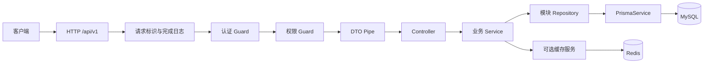

# 模块化单体架构

更新：2026-10-21。方案：建议采用，见 [ADR 0001](../decisions/0001-modular-monolith.md)；目标模块均未据此生成。

## 请求与模块边界



成功由响应拦截器包装，异常由全局过滤器输出安全错误。Guard 在 Pipe 之前运行，不能依赖 DTO 已转换或校验；认证服务自行校验 token。完成日志在 response finish/close 收集最终状态，覆盖 Guard、Pipe 和过滤器提前返回的请求。

## 职责划分

| 层/模块 | 负责 | 不负责 |
| --- | --- | --- |
| Controller | 路由、DTO、状态码、Swagger、调用用例 | Prisma 查询、哈希和跨表事务 |
| 业务 Service | 不变量、对象级权限、事务边界、调用领域协作者 | HTTP response、通用数据库封装 |
| 模块 Repository | Prisma 查询、软删条件、select 白名单、接收 TransactionClient | HTTP 状态、绕过业务授权 |
| DatabaseModule | 一个 PrismaService、适配器、连接生命周期 | 用户/角色等业务规则 |
| AuthModule | 密码、JWT、会话、全局认证 Guard | 角色权限配置 |
| AuthorizationModule | 权限装饰器/Guard、角色分配、权限版本 | 签发 token |
| UsersModule | 身份资料和状态，对外导出 UsersService | 导出 Repository 给其他模块直接写表 |
| RedisModule | 单个 Redis 连接、关闭和故障事件 | 作为身份/权限权威数据源 |
| Common | 纯装饰器、DTO 基类、过滤器、拦截器 | 汇总各业务 Service 的“大公共模块” |

Repository 只在存在实际查询时创建，每业务模块一个具体类即可，不创建 BaseRepository、DDD 层套层或工作单元框架。数据库资源模块显式导入，配置模块可全局加载。

依赖方向：`AppModule → Users/Auth/Authorization/Health`；`Auth → Users + Database`；`Authorization → Users + Database`；`Users → Database`。认证只读取用户和会话，不依赖权限模块；权限模块不反向导入 Auth。路由元数据/用户上下文类型放 common，避免循环依赖。用户禁用、删除、改密码在数据库事务里更新用户版本并撤销会话，无需 Users 调用 Auth。

## 目标目录（不是当前已存在的目录）

```text
doc/                         # 唯一技术文档源
AGENTS.md                    # 会话核心规则
project/
  prisma/schema.prisma
  prisma/migrations/
  prisma7.config.ts
  src/
    config/env.validation.ts
    common/{decorators,dto,filters,interceptors,middleware,types}/
    infrastructure/database/{prisma.module,prisma.service}.ts
    infrastructure/redis/{redis.module,redis.service}.ts
    modules/
      users/{dto,users.controller,users.service,users.repository,users.module}.ts
      auth/{dto,guards,auth.controller,auth.service,auth.module}.ts
      authorization/{dto,guards,authorization.module,authorization.service}.ts
      health/
      files/
      audit/
    generated/prisma/        # generate 产物，不手改，不入库
    app.module.ts
    main.ts
  test/
  Dockerfile
  compose.yaml
  .env.example
```

目录中的大括号表示文件分组，不是创建名；`dto/`、`guards/` 是目录，其他名称对应 `.ts`。生成器产物位于 src 下，参与 tsc 构建并进入 dist，防止容器遗漏客户端。

## 一致性与安全

- MySQL 是用户、会话、权限的唯一事实来源。Repository 默认排除 deletedAt；认证每次校验用户状态、tokenVersion、会话撤销，权限 Guard 初期每次查询数据库，立即感知权限变化。
- 缓存只缓存短期展示资料；第 07 阶段默认不给身份/权限读加缓存。数据提交后删缓存，失败报警并靠短 TTL 收敛，不能声称与 MySQL 强一致。需要可靠失效时再设计 outbox。
- 跨表写入由 Service 启动短事务，Repository 使用传入的 tx；事务内不发邮件、不访问 Redis、不上传文件、不运行慢密码哈希。外部副作用在提交后执行，失败可重试。
- 所有管理接口默认拒绝匿名访问；权限校验还需验证目标资源归属。角色名或 JWT 中旧权限不能作为实时授权依据。没有权限元数据的非公开路由默认 403，明确的“仅需认证”路由用装饰器声明。
- 初期不启用任意 SQL 拼接、自动全局缓存、自动 schema 同步和硬删除 HTTP 接口。

## 演进触发条件

业务模块增长先扩展 Nest Module；查询复杂才细分 Repository；热点读通过指标决定缓存；多实例定时任务先使用单调度器/可靠锁；出现跨进程可靠事件需求再引入 outbox/队列；只有独立发布、隔离或容量需求成立时讨论拆分服务。
